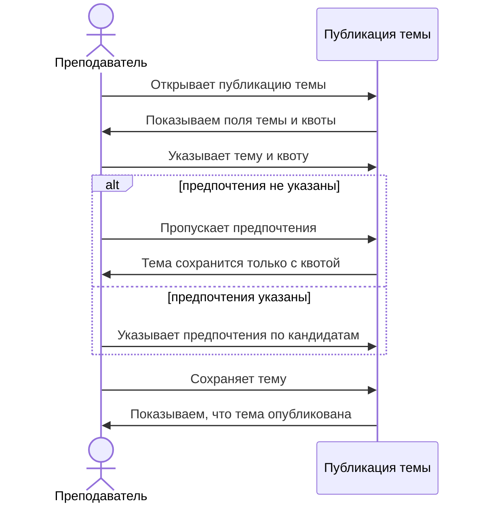
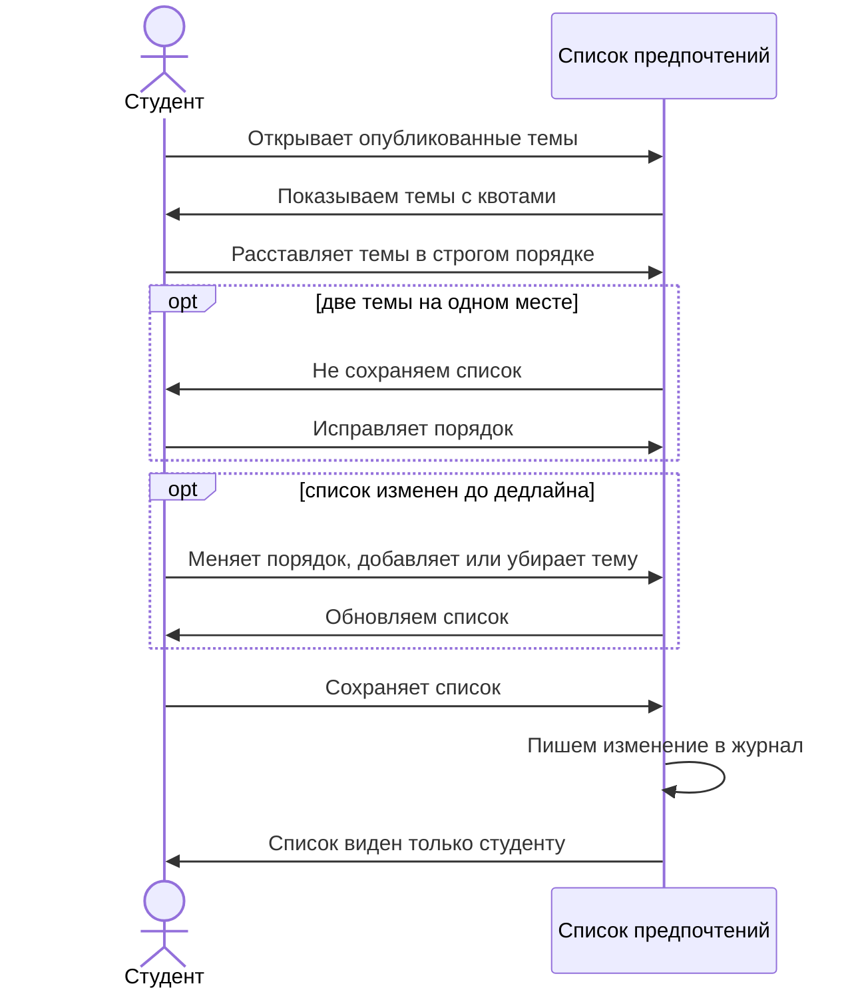
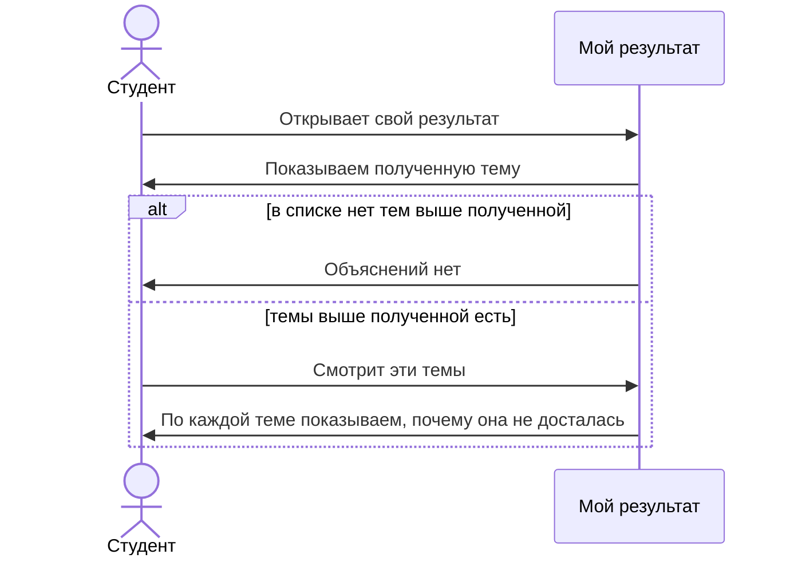

# Бизнес-требования: Ярмарка тем

## История изменений

| Дата       | Автор         | Изменения                                                                                                                                     |
|------------|---------------|-----------------------------------------------------------------------------------------------------------------------------------------------|
| 16.11.2026 | Шелест Максим | Первичная постановка по TASK-1: ограничения из брифа и честная оговорка                                                                       |
| 20.11.2026 | Шелест Максим | TASK-12: три роли из брифа, матрица возможностей и входные данные для разделов BRD, ДОП-3 по администратору и уточнен термин блокирующая пара |
| 24.11.2026 | Шелест Максим | TASK-14: истории ролей и сценарии UC-01, UC-02, UC-03 по брифу. Связь с BR после задачи №15                                                   |

## Термины и сокращения

| № | Термин              | Определение                                                                                                                                                                                                                   |
|---|---------------------|-------------------------------------------------------------------------------------------------------------------------------------------------------------------------------------------------------------------------------|
| 1 | Раунд               | Период публикации тем, сбора списков предпочтений до дедлайна и построения распределения                                                                                                                                      |
| 2 | Тема                | Предложение курсовой или электива с квотой мест                                                                                                                                                                               |
| 3 | Квота               | Число мест на теме                                                                                                                                                                                                            |
| 4 | Список предпочтений | Строгий порядок тем у студента                                                                                                                                                                                                |
| 5 | Блокирующая пара    | Пара «студент и тема», которые предпочли бы друг друга тому, что получили. Если такая пара есть, распределение развалится в реальности - студенты могут договориться в обход системы. В брифе то же названо «нарушающая пара» |

## Резюме

«Ярмарка тем» - сервис распределения студентов по темам и научным руководителям без преимущества тому, кто быстрее
написал в личку.

Преподаватели публикуют темы с квотами и, если хотят, своими предпочтениями по кандидатам. Студенты до общего дедлайна
расставляют интересные темы по порядку и могут передумать. После дедлайна система строит распределение и объясняет
результат: по каждой теме выше полученной видно, почему она не досталась.

Объяснение и есть продукт. Таблицу с фамилиями умеет и электронная почта. Роли: студент, преподаватель, администратор
раунда.

## Границы проекта

### Входит в рамки

- роли студент, преподаватель, администратор раунда
- публикация тем с квотами и необязательными предпочтениями преподавателя
- строгий список предпочтений студента до дедлайна, с возможностью передумать
- журнал изменений списков
- распределение без блокирующих пар и объяснение результата студенту
- синтетические данные для разработки и демонстрации

### Не входит в рамки

| Что не входит                                                  | Причина                                                                                            |
|----------------------------------------------------------------|----------------------------------------------------------------------------------------------------|
| Поиск наилучшего распределения при совпадениях в предпочтениях | В брифе: при совпадениях задача NP-трудная; совпадения снимает жеребьевка, зафиксированная заранее |
| Связанные заявки («одна тема на двоих»)                        | вне рамок по брифу                                                                                 |
| Несколько раундов с переносом остатков                         | вне рамок по брифу                                                                                 |
| Интеграция с деканатом и внешними системами                    | вне рамок по брифу                                                                                 |
| Реальные персональные данные студентов                         | в брифе только синтетика; реальный запуск - по отдельной договоренности                            |

## Ограничения и допущения

### Ограничения продукта

| ID    | Ограничение                                                                                      | Цитата / место в брифе                                                                                                                 |
|-------|--------------------------------------------------------------------------------------------------|----------------------------------------------------------------------------------------------------------------------------------------|
| ОГР-1 | Решение с нужным свойством существует при любых предпочтениях и строится за полиномиальное время | «Задача имеет решение всегда, и оно строится за полиномиальное время»; «Решение с нужным свойством существует при любых предпочтениях» |
| ОГР-2 | Не должно существовать пары «студент и тема», которые предпочли бы друг друга тому, что получили | «не должно существовать пары „студент и тема“, которые предпочли бы друг друга тому, что получили»                                     |
| ОГР-3 | Порядок предпочтений студента строгий; совпадения не допускаются как равные позиции в списке     | «Строгий порядок предпочтений остается требованием продукта, а совпадения разрешаются жеребьевкой, зафиксированной заранее»            |
| ОГР-4 | До дедлайна предпочтения не видны никому, кроме владельца                                        | «До дедлайна они точно не должны быть видны никому, кроме владельца»                                                                   |
| ОГР-5 | Каждое изменение списков остается в журнале                                                      | «Каждое изменение списков должно оставаться в журнале»                                                                                 |
| ОГР-6 | Данные для разработки и демонстрации только синтетические                                        | «все на синтетических»; «Все данные для разработки и демонстрации синтетические»                                                       |

### Свойства механизма из профильной оси

| ID   | Утверждение                                                                     | Цитата / место в брифе                                                   |
|------|---------------------------------------------------------------------------------|--------------------------------------------------------------------------|
| СВ-1 | Среди решений без блокирующих пар есть одно, наилучшее сразу для всех студентов | «Среди всех таких решений есть одно, наилучшее сразу для всех студентов» |
| СВ-2 | Студенту невыгодно указывать предпочтения неискренне                            | «Студенту невыгодно указывать предпочтения неискренне»                   |

### Допущения

| ID    | Допущение                                                                                                   | Почему допущение, а не правило                            |
|-------|-------------------------------------------------------------------------------------------------------------|-----------------------------------------------------------|
| ДОП-1 | Регламент раунда (студент без заявки, тема без выбора, сколько раз можно менять список) еще не зафиксирован | Бриф явно отдает это команде; цифры и решения не выдуманы |
| ДОП-2 | Сколько позиций студент готов ранжировать - неизвестно до интервью                                          | Бриф: «вопрос к живым людям, а не к воображению»          |
| ДОП-3 | Перечень действий администратора раунда в продукте еще не зафиксирован                                      | В брифе роль названа, обязанности не описаны              |

## Заинтересованные стороны

### Роли пользователей системы

| Роль                 | Кто                | Зона ответственности                                                                                              |
|----------------------|--------------------|-------------------------------------------------------------------------------------------------------------------|
| Студент              | Участник раунда    | Список предпочтений до дедлайна (можно передумать), просмотр своего результата и объяснения, которое дает система |
| Преподаватель        | Автор тем          | Темы с квотами и необязательные предпочтения по кандидатам                                                        |
| Администратор раунда | Организатор раунда | Организация раунда. Конкретные действия в брифе не описаны (ДОП-3)                                                |

### Матрица «роль - возможности»

Обозначения значений: да - из брифа; нет - вне рамок или не следует из брифа; не задано - в брифе не описано правило

| Возможность                                          | Студент | Преподаватель | Администратор раунда | По брифу                                                     |
|------------------------------------------------------|---------|---------------|----------------------|--------------------------------------------------------------|
| Публиковать тему с квотой                            | нет     | да            | нет                  | бриф                                                         |
| Указывать предпочтения по кандидатам (необязательно) | нет     | да            | нет                  | бриф                                                         |
| Вести свой список предпочтений до дедлайна           | да      | нет           | нет                  | бриф                                                         |
| Менять свой список до дедлайна                       | да      | нет           | нет                  | бриф: «можно передумать» (сколько раз - это открытый вопрос) |
| Видеть чужие предпочтения до дедлайна                | нет     | нет           | нет                  | бриф: до дедлайна видны только владельцу                     |
| Изменения своего списка остаются в журнале           | да      | да            | не задано            | бриф: каждое изменение списков должно оставаться в журнале   |
| Получить свой результат и объяснение                 | да      | нет           | нет                  | бриф: объяснение студенту по темам выше полученной           |
| Видеть всех кандидатов / чужие результаты            | нет     | не задано     | не задано            | бриф: открытый вопрос про права преподавателя                |
| Действия администратора раунда (дедлайн, запуск)     | нет     | нет           | не задано            | роль есть, список действий не задан (ДОП-3)                  |
| Интеграция с деканатом / внешними системами          | нет     | нет           | нет                  | вне рамок                                                    |

### Стейкхолдеры, которые дают входные данные для разделов BRD

| Раздел                                                  | Сейчас в BRD                         | Кто / что дает вход                           |
|---------------------------------------------------------|--------------------------------------|-----------------------------------------------|
| Границы проекта, ограничения ОГР, свойства СВ, RULE-01  | заполнено                            | Текст брифа                                   |
| Заинтересованные стороны и матрица «роль — возможности» | заполнено                            | Бриф (три роли). Уточнения на интервью        |
| Регламент раунда, длина списка, права преподавателя     | не заполнено (открытые вопросы)      | Интервью с носителями ролей и решение команды |
| Метрики, AS IS, аналоги, BR, матрица по экранам         | разделов еще нет                     | По шаблону курса после интервью и прототипа   |
| Сценарии UC-01, UC-02, UC-03 и истории ролей            | заполнено, связь с BR не проставлена | Бриф. Номера BR появятся в задаче №15         |

## Истории ролей

Критерий приемки у каждой истории проверяется по брифу. Число правок списка и действия администратора раунда не
фиксируются: это открытые вопросы.

| ID    | История                                                                                                                         | Критерии приемки                                                                                                                                                                                   |
|-------|---------------------------------------------------------------------------------------------------------------------------------|----------------------------------------------------------------------------------------------------------------------------------------------------------------------------------------------------|
| US-01 | Как студент, я хочу до дедлайна составить строгий список тем по порядку, чтобы получить тему без гонки в личку                  | Список сохраняется до дедлайна. Две темы не стоят на одном месте. До дедлайна список виден только студенту. Каждое изменение списка остается в журнале. Сколько раз можно менять список, не задано |
| US-02 | Как студент, я хочу после дедлайна увидеть свою тему и объяснение по темам выше нее, чтобы понять, почему они не достались      | Студент видит только свой результат. По каждой теме списка выше полученной показано, почему она не досталась                                                                                       |
| US-03 | Как преподаватель, я хочу опубликовать тему с квотой, чтобы студенты могли поставить ее в список                                | У темы есть квота мест. Тема доступна для списка студента                                                                                                                                          |
| US-04 | Как преподаватель, я хочу при публикации указать предпочтения по кандидатам, чтобы учесть их в распределении, если я этого хочу | Предпочтения можно не указывать. Тема публикуется и без них                                                                                                                                        |
| US-05 | Как администратор раунда, я хочу провести раунд, чтобы сбор списков закончился в общий дедлайн                                  | Роль в продукте есть. Какие действия администратор выполняет в системе, бриф не задает (ДОП-3). Отдельного сценария нет                                                                            |

## Сценарии использования

Одна роль на сценарий. Колонка «Связь с BR» заполнится номерами BR-01 и в задаче №15.

#### UC-01: Публикация темы с квотой

**Роль:** Преподаватель

**Предусловия:** идет публикация тем до дедлайна раунда.

**Постусловия:** тема с квотой сохранена и доступна студенту для списка. Предпочтения по кандидатам сохранены только
если преподаватель их указал.

**Диаграмма:**

| Шаг | Действие пользователя                              | Действие системы                                                                   | Экранная форма  | Связь с BR            |
|-----|----------------------------------------------------|------------------------------------------------------------------------------------|-----------------|-----------------------|
| 1   | Преподаватель открывает публикацию темы            | Система показывает поля темы и квоты                                               | Публикация темы | появится в задаче #15 |
| 2   | Преподаватель указывает тему и квоту мест          | Система принимает квоту как число мест                                             | Публикация темы | появится в задаче #15 |
| 3   | Преподаватель указывает предпочтения по кандидатам | Система принимает предпочтения. Сохранение темы на шаге 4                          | Публикация темы | появится в задаче #15 |
| 3а  | Преподаватель пропускает предпочтения              | Система не требует предпочтения. Тема сохранится только с квотой. Переход к шагу 4 | Публикация темы | появится в задаче #15 |
| 4   | Преподаватель сохраняет тему                       | Система сохраняет тему и показывает, что она опубликована                          | Публикация темы | появится в задаче #15 |
| 5   | –                                                  | Сценарий завершен                                                                  | –               | –                     |

#### UC-02: Список предпочтений студента

**Роль:** Студент

**Предусловия:** дедлайн не наступил. Хотя бы одна тема опубликована.

**Постусловия:** сохранен строгий порядок тем. До дедлайна список виден только студенту. Изменение списка записано в
журнал.

**Диаграмма:**

| Шаг | Действие пользователя                                          | Действие системы                                                                            | Экранная форма      | Связь с BR            |
|-----|----------------------------------------------------------------|---------------------------------------------------------------------------------------------|---------------------|-----------------------|
| 1   | Студент открывает опубликованные темы                          | Система показывает темы с квотами                                                           | Список предпочтений | появится в задаче #15 |
| 2   | Студент расставляет выбранные темы в строгом порядке           | Система проверяет, что две темы не стоят на одном месте                                     | Список предпочтений | появится в задаче #15 |
| 2а  | Студент ставит две темы на одно место                          | Система не сохраняет список. Сценарий возвращается к шагу 2                                 | Список предпочтений | появится в задаче #15 |
| 2б  | До дедлайна студент меняет порядок, добавляет или убирает тему | Система обновляет список. Переход к шагу 3. Сколько раз можно менять список, бриф не задает | Список предпочтений | появится в задаче #15 |
| 3   | Студент сохраняет список                                       | Система сохраняет порядок, оставляет его видимым только студенту и пишет изменение в журнал | Список предпочтений | появится в задаче #15 |
| 4   | –                                                              | Сценарий завершен                                                                           | –                   | –                     |

#### UC-03: Просмотр своего результата и объяснения

**Роль:** Студент

**Предусловия:** дедлайн наступил. Распределение построено.

**Постусловия:** студент видит полученную тему. По каждой теме его списка выше полученной видно, почему она не
досталась.

**Диаграмма:**

| Шаг | Действие пользователя                              | Действие системы                                                 | Экранная форма | Связь с BR            |
|-----|----------------------------------------------------|------------------------------------------------------------------|----------------|-----------------------|
| 1   | Студент открывает свой результат                   | Система показывает тему, которую он получил                      | Мой результат  | появится в задаче #15 |
| 2   | Студент смотрит темы своего списка выше полученной | Система по каждой такой теме показывает, почему она не досталась | Мой результат  | появится в задаче #15 |
| 2а  | В списке нет тем выше полученной                   | Система не показывает объяснений. Сценарий завершен              | Мой результат  | появится в задаче #15 |
| 3   | –                                                  | Сценарий завершен                                                | –              | –                     |

## Бизнес-правила

| ID      | Правило                                                                                                                                                                                                                                                       | Условие применения                                              | Связь с BR                              |
|---------|---------------------------------------------------------------------------------------------------------------------------------------------------------------------------------------------------------------------------------------------------------------|-----------------------------------------------------------------|-----------------------------------------|
| RULE-01 | Отсутствие блокирующей пары не означает, что двое студентов не могли бы выгодно обменяться темами. Такой обмен возможен; его удерживают предпочтения преподавателей, а не свойство распределения. Интерфейс не обещает пользователю больше, чем дает механизм | Показ результата распределения и тексты про честность механизма | появится с BR про объяснение результата |

## Открытые вопросы

| Вопрос                                                  | Ответственный | Дедлайн          | Статус |
|---------------------------------------------------------|---------------|------------------|--------|
| Что делать со студентом, не подавшим заявку             | БА, команда   | середина каркаса | ОТКРЫТ |
| Что делать с темой, которую никто не выбрал             | БА, команда   | середина каркаса | ОТКРЫТ |
| Сколько раз можно менять список до дедлайна             | БА            | середина каркаса | ОТКРЫТ |
| Сколько позиций студент реально готов ранжировать       | БА            | середина каркаса | ОТКРЫТ |
| Видит ли преподаватель всех кандидатов или только своих | БА, команда   | КТ1              | ОТКРЫТ |
